# Scale by Underground

**A two-sided marketplace that connects music students with independent teachers.** Students find a teacher, book a weekly one-on-one course, pay once and track their progress. Teachers publish courses, run their schedule and students, and get paid lesson by lesson.

This repository is the working MVP prototype: a mobile-first web app that reproduces the iOS 26 designs, with all eight MVP flows running on one shared set of data.

**[Open the live prototype](https://rockysahooart.github.io/underground-mvp/)** (best at phone width, or on an iPhone) · [Design decisions](DECISIONS.md) · [Run it locally](#run-it-locally)

<table>
  <tr>
    <td>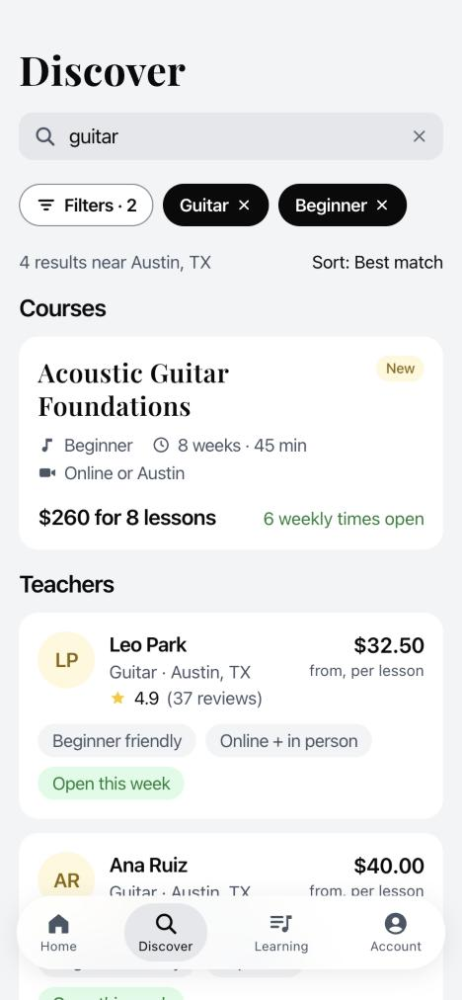</td>
    <td>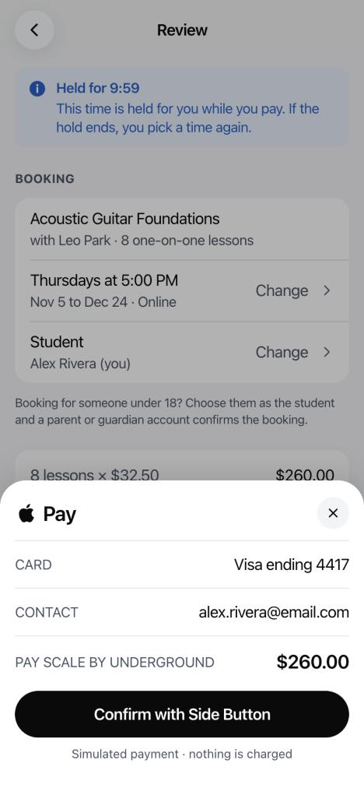</td>
    <td>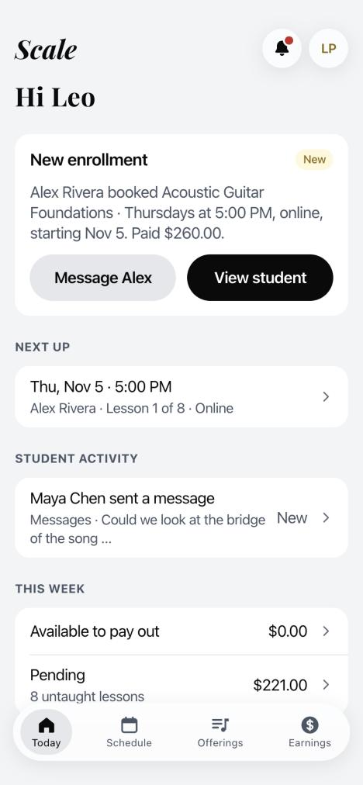</td>
  </tr>
</table>

All people, prices and payments in the prototype are fictional. Nothing is charged, sent or verified.

---

## Contents

1. [The problem](#the-problem)
2. [Who it serves](#who-it-serves)
3. [Business model](#business-model)
4. [The marketplace loop](#the-marketplace-loop)
5. [The eight MVP flows](#the-eight-mvp-flows)
6. [Key design decisions](#key-design-decisions)
7. [Designing for iOS, building for the web](#designing-for-ios-building-for-the-web)
8. [Accessibility](#accessibility)
9. [From design to working prototype](#from-design-to-working-prototype)
10. [How it was validated](#how-it-was-validated)
11. [Trade-offs and open decisions](#trade-offs-and-open-decisions)
12. [What is not validated yet, and next steps](#what-is-not-validated-yet-and-next-steps)
13. [Try the demo](#try-the-demo)
14. [Run it locally](#run-it-locally)

---

## The problem

Independent music teachers usually run their business by hand: they advertise through word of mouth, schedule over text messages, take payment through separate apps and track each student's progress in their head or a notebook. Students, especially adult beginners, struggle to judge whether a teacher is right for them, what they will actually learn, and what they are paying for.

Underground (with **Scale** as its learning product) puts both sides of that relationship in one place: discovery, evaluation, booking, payment, scheduling, progress and earnings.

## Who it serves

| | Student | Teacher |
|---|---|---|
| **Example in the prototype** | Alex Rivera, an adult who has never played guitar | Leo Park, an independent guitar teacher in Austin |
| **Goals** | Find a teacher they trust, know what they will learn and when, pay once, see progress | Fill their weekly hours, sell structured courses, spend less time on admin, get paid reliably |
| **Key worries** | "Is this teacher any good?" "What happens if I need to cancel?" | "When do I actually get paid?" "What does the platform take?" |
| **Where the design answers them** | Verified badges, reviews only from real lessons, curriculum and outcomes before booking, refund amount shown before cancelling | Live earnings preview while pricing, a per-lesson release schedule, weekly payouts with a clear status |

One account can hold both roles, and switching never signs the user out. Music schools are a later phase and appear disabled in teacher onboarding.

## Business model

Underground is transaction-based: teachers set their own price per lesson, and the marketplace keeps a fee from each booking.

| Term | Rule | Worked example: 8 lessons at $32.50 |
|---|---|---|
| Course price | listed price × lessons, paid once at booking | $260.00 |
| Student service fee | 0% in the prototype; the line stays visible so a future fee is not a surprise | $0.00 |
| Marketplace fee | 15% of the course price, taken from the teacher | $39.00 |
| Teacher net | course price − fee | $221.00 |
| Per-lesson release | net ÷ lessons, rounded; the last lesson takes the remainder | $27.63 × 7, then $27.59 |
| Refund on cancellation | full listed price for every untaught lesson | after lesson 1: $227.50 |

The 15% rate is a placeholder pending a business decision, so it lives in one config value (`FEE_RATE` in [`src/data/money.ts`](src/data/money.ts)) and is never written into a screen. All money is stored and calculated in integer cents, and unit tests check the worked example.

Money moves through four visible states for the teacher: **Pending** (paid, not taught) → **Available** (taught, waiting for Monday) → **Paid out**, or **Refunded** if a student cancels.

## The marketplace loop

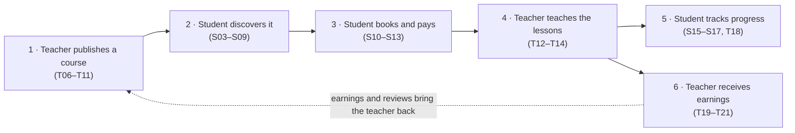

The prototype's main job is to prove this loop works end to end. Both roles read the **same records**: the booking a student makes is the record the teacher sees, a lesson the teacher marks complete changes the student's progress and the teacher's balance at once, and a cancellation refunds the student and reduces the teacher's pending balance in one step. Derived values (open times, ratings, balances, progress) are computed from those records every time, never stored twice, so the two sides cannot disagree.

## The eight MVP flows

Screen IDs are fixed: **A** = both roles, **S** = student, **T** = teacher. They are used in routes, component names and the handoff, so every screen traces back to its specification.

| Flow | Screens | States designed and built |
|---|---|---|
| **01 Onboarding** (both roles) | A01 Welcome, A02 Create Account, A03 Choose Role, A04 Sign In, S01 Interests, S02 Level and Format, T01–T05 teacher setup | Email In Use, inline validation, ID check Pending, setup resumes at the last unfinished step |
| **02 Teacher discovery** | S04 Discover, S05 Search Results, S06 Filters | Loading skeletons after 300 ms, No Results with a way out, Offline with saved results, live result count on the filter button |
| **03 Teacher and course evaluation** | S07 Teacher Profile, S08 Course Details, S09 Reviews | "New teacher" under 3 reviews, No Open Times with "Notify me", Enrolled |
| **04 Booking and payment** | S10 Choose Time, S11 Review and Pay, S12 payment sheet, S13 Booked, S14 Cancel Course | Time Taken (live), 10-minute hold with countdown, Card Declined, hold expired, Guardian Booking (under 18) |
| **05 Course creation and publishing** | T06 Offerings, T07 Basics, T08 Curriculum, T09 Price and Schedule, T10 Preview and Publish, T11 Published | Empty, Title Missing, Price Too Low, readiness checklist, Confirm Publish, save draft at any step |
| **06 Scheduling and student management** | T12 Today, T13 Schedule, T14 Session Detail, T15 Students, T16 Student Detail, T17 Edit Availability | Empty Day, Reschedule request, Cancel Lessons, Mark complete locked until the lesson starts |
| **07 Learning and progress** | S03 Home, S15 Course Progress, S16 Lesson Notes, S17 Log Practice, S18 Write a Review, T18 Update Progress | No Courses, Completed, Discard Changes |
| **08 Earnings** | T19 Earnings, T20 Booking Earnings, T21 Payouts | Empty, Refunded, Payout Failed |
| **Shared** | A05 Notifications, A06 Messages, A07 Account, A08 Delete Account, A09 Report a Concern | Reschedule accept with a 5-second undo, failed message retry, delete with refund summary |

### Student journey

<table>
  <tr>
    <td align="center">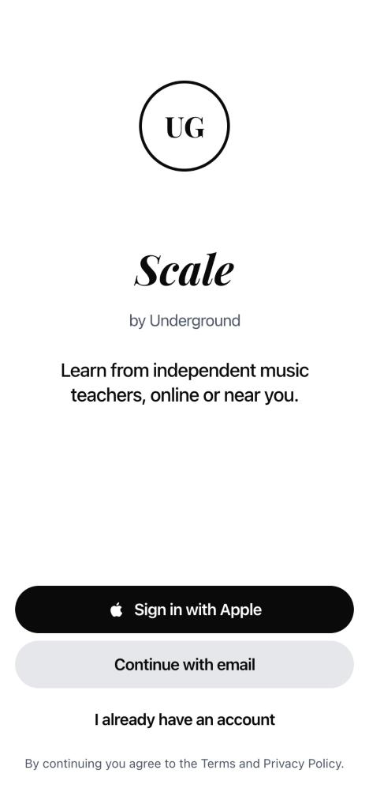<br><sub>A01 Welcome</sub></td>
    <td align="center"><br><sub>S05 Search Results</sub></td>
    <td align="center">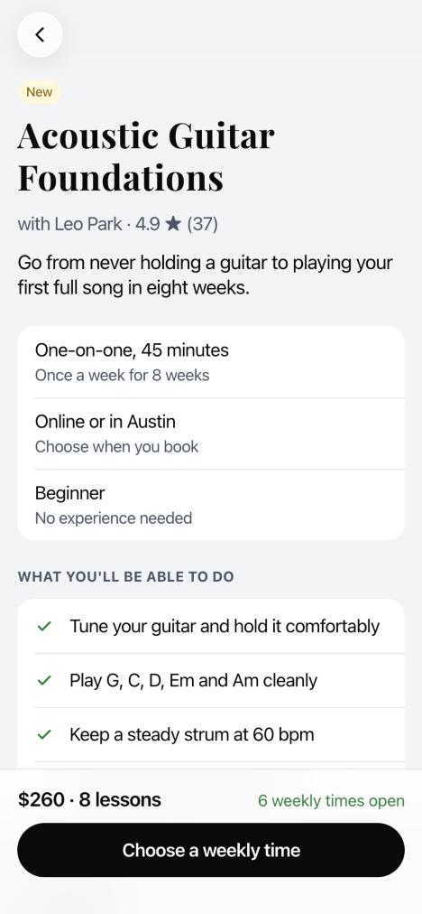<br><sub>S08 Course Details</sub></td>
  </tr>
  <tr>
    <td align="center">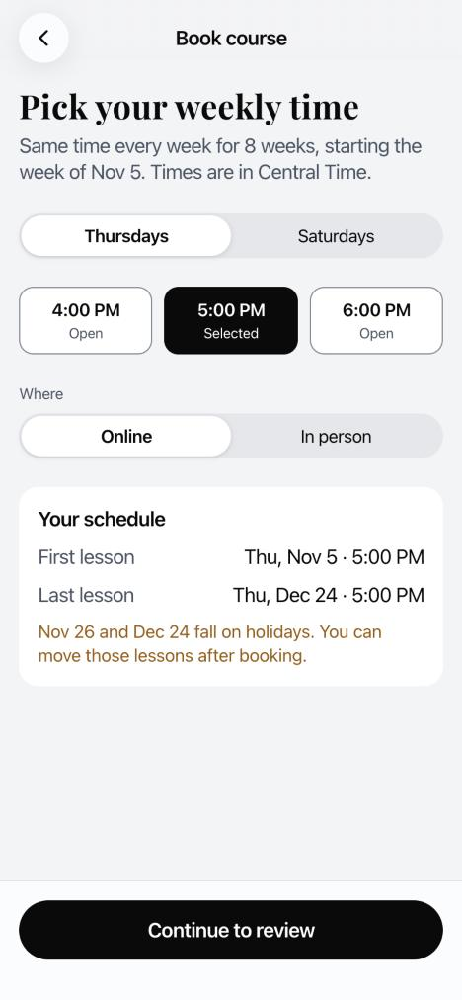<br><sub>S10 Choose Time</sub></td>
    <td align="center"><br><sub>S11 + S12 Review and Pay</sub></td>
    <td align="center">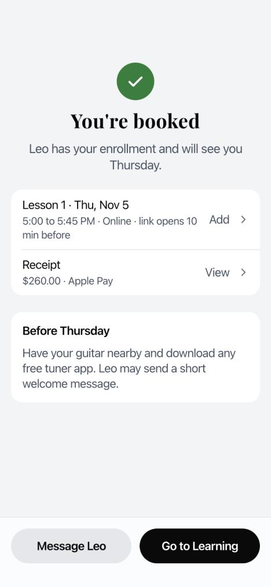<br><sub>S13 Booked</sub></td>
  </tr>
  <tr>
    <td align="center">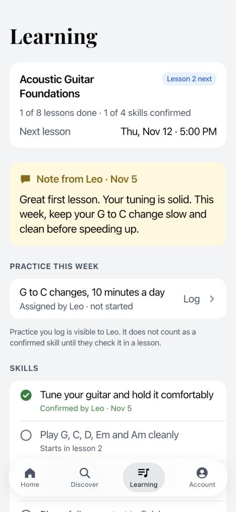<br><sub>S15 Course Progress</sub></td>
    <td></td>
    <td></td>
  </tr>
</table>

### Teacher journey

<table>
  <tr>
    <td align="center">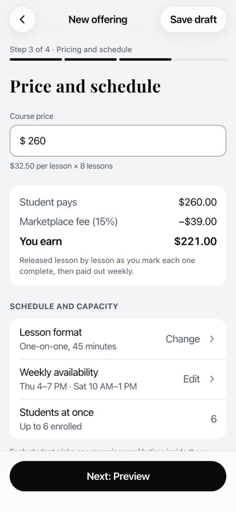<br><sub>T09 Price and Schedule</sub></td>
    <td align="center">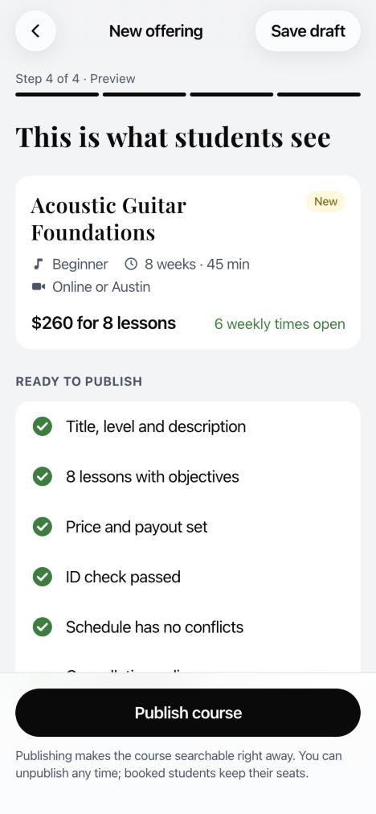<br><sub>T10 Preview and Publish</sub></td>
    <td align="center"><br><sub>T12 Today</sub></td>
  </tr>
  <tr>
    <td align="center">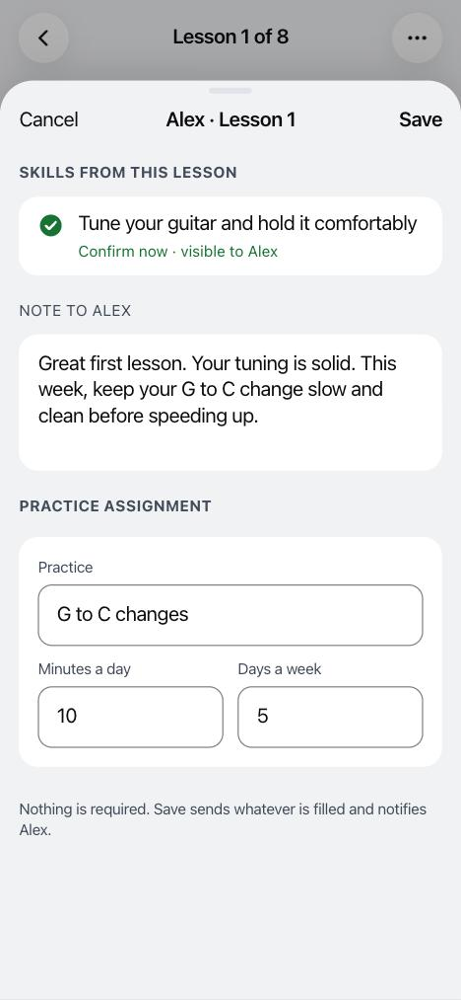<br><sub>T18 Update Progress</sub></td>
    <td align="center">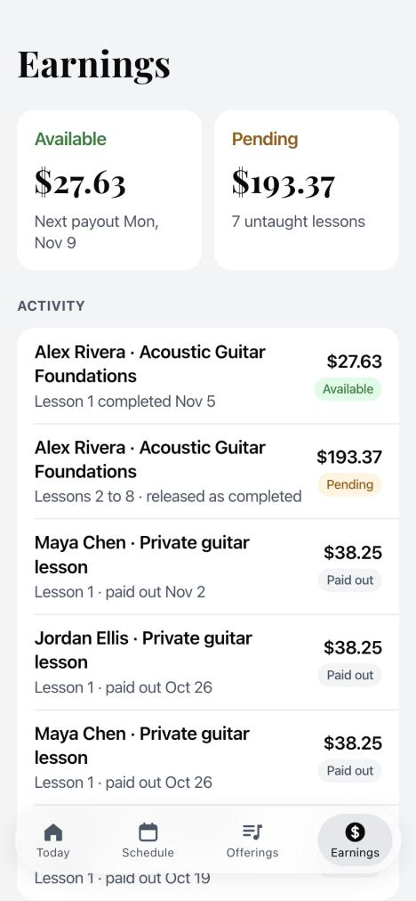<br><sub>T19 Earnings</sub></td>
    <td></td>
  </tr>
</table>

## Key design decisions

**Booking is a weekly time, not a calendar slot.** A course is the same time every week (for example, Thursdays at 5:00 PM for 8 weeks). The student picks one recurring time on S10 and sees the first and last lesson dates, plus a warning when a date falls on a holiday. This matches how private lessons actually run and keeps checkout to three steps.

**The price students see is the price they pay.** Prices are shown per lesson and as a course total, and the review screen lists the service fee and tax as $0.00 rather than hiding them. Teachers carry the marketplace fee and see it before publishing, in a live preview that recalculates as they type.

**Teachers see exactly when money becomes theirs.** Instead of one "earnings" number, money is released lesson by lesson as each is marked complete. T20 shows the release schedule per booking ($27.63 × 7, then $27.59), and the bottom bar on T14 says what completing the lesson releases.

**Holding a time protects both sides.** Tapping Pay holds the time for 10 minutes; other students see it as Booked. The hold is shown as a countdown, and if it lapses the student returns to S10 with "Your hold ended. Pick a time again." If the slot is taken while a student is choosing, it greys out live and the selection clears.

**Every error says whether money moved and what to do next.** A declined card reads "Your card was declined. You were not charged," keeps the hold and offers "Use a different card." A failed payout tells the teacher the amount, why it was returned, and that the money is safe in Available.

**Progress is lessons plus confirmed skills, never a percentage.** Each lesson in a curriculum carries a milestone. A milestone becomes *Practicing* when its lesson is taught and *Confirmed* only when the teacher confirms it after a lesson. Practice the student logs is visible to the teacher but never changes a skill's status, so progress always reflects the teacher's judgment. The three states use different icon shapes so they survive grayscale.

**Trust signals come from real activity.** Reviews can only come from students who completed a booked lesson. Ratings appear only after 3 reviews; before that the teacher shows a "New teacher" badge. Verified ID and background check badges come from the verification step in teacher setup, and a course cannot be published until the ID check passes.

**Booking access comes before biography.** On the teacher profile, the list of offerings sits above the About section so a student who is ready can book without scrolling past the bio.

**Back never reopens payment.** After S13, the checkout history is replaced, and "Go to Learning" resets the stack, so the browser or swipe Back cannot reopen a payment sheet for something already paid.

**Students under 18 book through a guardian.** Date of birth is collected at sign-up and explained in place. In the MVP, choosing a student under 18 shows the guardian flow and blocks payment with a clear notice, rather than silently allowing it.

**Teachers onboard in five short, saved steps.** Type, specialties, weekly hours, payouts and verification, then a preview of the public profile. Bank and ID can be skipped and finished later; leaving and returning resumes at the last unfinished step.

## Designing for iOS, building for the web

The designs follow iOS 26 and Apple's Human Interface Guidelines. The prototype is a website, so each native behavior has a web equivalent:

| iOS behavior in the designs | How the prototype does it |
|---|---|
| Floating Liquid Glass tab bar | A fixed, translucent bar (`backdrop-filter`), opaque when Reduce Transparency is on. Glass is used only on the tab bar, navigation buttons and bottom action bars, never behind body text |
| Push navigation with a Back button | Hash routes per screen; the on-screen Back and the browser Back behave the same |
| Sheets with detents and a grabber | Bottom sheets at medium or large height; Cancel, Escape or tapping outside closes them; asks to discard only if something was typed |
| Alerts and action sheets | Custom dialogs drawn to match, with the safe option bold and the destructive option red |
| Apple Pay sheet | A custom sheet labeled "Simulated payment"; no card data is ever collected |
| Sign in with Apple | A button that simulates a successful sign-in |
| Push notifications | An in-app notifications list plus a toast for the active user |
| SF Pro and SF Symbols | The system font stack (SF Pro on Apple devices) and hand-drawn SVG stand-ins for the named symbols; Playfair Display carries the brand in titles |
| Safe areas and the home indicator | `viewport-fit=cover` and `env(safe-area-inset-*)` padding on fixed bars |

Colors, type, spacing and radii come from the design tokens and live in one file, [`src/styles/tokens.css`](src/styles/tokens.css). Screens use the tokens and never hard-code colors.

## Accessibility

The target is WCAG 2.2 AA.

- **Contrast:** text uses only the design tokens, whose contrast was measured in Figma. Field and chip borders use a darker border token to meet the 3:1 non-text contrast rule. The gold rating star is decorative, so the number always sits next to it.
- **Never color alone:** status badges always have text, milestone states differ by icon shape, errors have an icon and a message, and booked times say "Booked."
- **Structure:** each screen title is the page heading and receives focus after navigation; the tab bar is a navigation landmark; cards read as one element with a full description ("Leo Park, guitar, from $32.50 per lesson, rated 4.9 out of 5, 37 reviews. Opens profile.").
- **Forms:** visible labels, errors shown on leaving a field or tapping the main button, focus moves to the first invalid field, and errors are linked to their field and announced.
- **Status messages:** toasts, the booking hold, "Checking your booking" and the undo toast are announced politely to screen readers.
- **Keyboard:** every action works with a keyboard; sheets and dialogs trap focus and close with Escape.
- **Touch targets:** 44 × 44 pt minimum; chips are 36 pt tall inside a 44 pt hit area.
- **Motion:** pushes slide and sheets rise, and both become a short cross-fade when Reduce Motion is on.
- **Dragging alternative:** reordering lessons has Move up and Move down buttons, so dragging is never required.

An automated scan with axe-core (WCAG 2.0, 2.1 and 2.2, levels A and AA) reported no violations on every student and teacher screen, the filters sheet and the report sheet. Automated checks do not cover everything; see [What is not validated yet](#what-is-not-validated-yet-and-next-steps).

## From design to working prototype

1. **Design:** high-fidelity iOS 26 screens for both roles in Figma, with component states, tokens and flow diagrams.
2. **Implementation handoff:** a 98-page document that puts every screen image next to its full specification: purpose, entry points, layout, components, actions, validation, states, data changes, cross-role effects, accessibility and open questions. It also defines the data model, the state machines for bookings, payments and payouts, a seed data set and a 13-step acceptance scenario.
3. **Build:** the prototype was implemented from the handoff with Claude Code (Anthropic's AI coding tool), following the specification screen by screen, and compared side by side against the screen images.
4. **Validate:** the acceptance scenario, an automated accessibility scan, performance measurements and a test on the deployed site (below).

Writing the handoff as the source of truth paid off. Because every value was either specified or explicitly marked UNSPECIFIED, the build could follow the design without inventing behavior, and every gap was logged as a decision instead of guessed silently. The full list is in [DECISIONS.md](DECISIONS.md).

## How it was validated

**The connected journey.** The handoff's 13-step scenario was run end to end in a 390 × 844 viewport, switching between Leo and Alex. Each step produced the expected values:

| Step | What happens | Checked result |
|---|---|---|
| 1–3 | Leo creates and publishes "Acoustic Guitar Foundations" | Earnings preview $221.00 after the 15% fee; every checklist row passes |
| 4–5 | Alex searches "guitar" and opens the course | "4 results near Austin, TX"; $260 for 8 lessons |
| 6–7 | Alex picks Thursdays at 5:00 PM and pays | $260.00 total, fee $0.00, tax $0.00; booking confirmed |
| 8–9 | Both sides update | Alex: next lesson Thu, Nov 5, 5:00 PM. Leo: new enrollment "Paid $260.00", Pending $221.00 |
| 10–11 | Leo teaches lesson 1 and saves progress | $27.63 moves to Available; skill confirmed; note and practice sent |
| 12 | Alex checks progress and logs practice | "1 of 8 lessons done · 1 of 4 skills confirmed"; Leo sees 15 min logged |
| 13 | Monday payout | Available $27.63, Pending $193.37, then $27.63 paid on Mon, Nov 9 |

**Alternate states.** Card decline and retry, a time taken by another student, an expired hold, reschedule request and accept with undo, student cancellation ($227.50 refund, reflected on the teacher's booking earnings), teacher cancellation, payout failure, course completion with a review that updates the teacher's rating, new-account onboarding for both roles, and the empty states.

**Quality checks.**

- No horizontal scrolling and no error screens on any route at 390 px wide; no console errors.
- Money unit tests pass (`npm test`).
- Performance on the live site: 4 requests on first load, all from the same origin (73 KB JavaScript, 7 KB CSS, 23 KB font). Largest Contentful Paint 452 ms and Cumulative Layout Shift 0.000, measured in a desktop browser at phone size **without** network or CPU throttling. The student and teacher screens load as separate bundles, so a student never downloads teacher screens.

## Trade-offs and open decisions

**Where the prototype differs from the screen images, and why** (details in [DECISIONS.md](DECISIONS.md)):

- Course pages start with "6 weekly times open" rather than 3, so the demo's earnings numbers stay exact. The "Booked" and "No open times" states are shown with the developer panel instead.
- The refunded-booking earnings screen shows the fee only on the lessons that were kept, so the numbers add up; the image's numbers did not.
- The Level filter adds an "Any" option so "no level filter" can be shown.
- Lessons are reordered with up and down buttons rather than dragging.
- Undesigned destinations (forgot password, editing bank details, most settings, receipts, add to calendar, video lessons) show a disabled control or a "not in the prototype" message rather than a dead end.

**Business decisions still open.** The prototype uses a default for each so the flows can run:

| Decision | Prototype default |
|---|---|
| Fee model | 15% from the teacher, $0 from the student |
| Is the fee refunded with refunded lessons? | Yes: the student gets the full listed price back per untaught lesson |
| Sales tax on lessons | $0.00, line kept visible |
| Hold length; price floor | 10 minutes; $15 per lesson, no ceiling |
| Unanswered reschedule after 48 hours | The original time is kept |
| What "No-show" and "I cancelled" do to payment and progress | The value is stored only |
| Guardian booking in the MVP | Shown, with payment blocked and a notice |
| Messaging before a booking | Allowed from the teacher profile |

## What is not validated yet, and next steps

Being explicit about the limits of this work:

- **No usability testing yet.** The flows have not been tested with real students or teachers. The first round should test the riskiest moments: choosing a weekly time, understanding the hold, cancelling with a refund, and the teacher's per-lesson earnings model.
- **Not tested on a real iPhone.** Safe areas, the keyboard, Add to Home Screen and VoiceOver were not checked on a device. Lighthouse with mobile throttling has not been run.
- **Dark mode is implemented from the tokens but was never designed or reviewed.**
- **Data lives in one browser.** Each device keeps its own demo data; there is no backend or sync between devices.
- **The fonts are 70 KB,** a little over the 60 KB budget.

Natural next steps: run moderated usability sessions with both roles, test on iPhone Safari with VoiceOver, settle the open business decisions above, design the screens currently marked "not in the prototype" (forgot password, receipts, editing a published course), and plan the music-school phase.

---

## Try the demo

Open the [live prototype](https://rockysahooart.github.io/underground-mvp/) at phone width. A small **Dev** pill in the top-left corner opens a developer panel to switch accounts and control the simulation. The demo clock starts on Mon, Nov 2, 2026, 10:00 AM Central.

1. Dev › **Leo Park · teacher**. Offerings › **+**, or Dev › **Create the demo course draft** to skip typing the 8 lessons.
2. Basics → Curriculum → Price: enter **260**. The preview shows a $39.00 fee and $221.00 earnings.
3. Preview: every checklist row is green. **Publish course** › **Publish**.
4. Dev › **Alex Rivera · student**. Discover › search **guitar**: 4 results, including the new course.
5. Open Leo › **View course**: $260 for 8 lessons.
6. **Choose a weekly time** › Thursday **5:00 PM** › **Continue to review**.
7. **Buy with Apple Pay** › **Confirm with Side Button** (simulated) › You're booked.
8. **Go to Learning**: the next lesson is Thu, Nov 5, 5:00 PM.
9. Dev › Leo: Today shows the new enrollment; Earnings shows Pending $221.00.
10. Dev › **Jump to the next lesson start**, open the lesson › **Mark complete and update progress**.
11. Confirm the skill, write a note, add practice › **Save**.
12. Dev › Alex: Learning shows "1 of 8 lessons done · 1 of 4 skills confirmed" and the note. Log 15 minutes of practice.
13. Dev › Leo › Earnings: Available $27.63, Pending $193.37. Dev › **Run Monday payout**: the payout history shows $27.63 on Mon, Nov 9.

The panel can also make the next payment decline, have another student hold a time, teach every remaining lesson (to see a completed course and leave a review), fail a payout, go offline, show empty search results and reset all demo data.

Sign-in details for the seeded accounts: `alex.rivera@email.com` / `demo-pass-1` (student) and `leo@scale.example` / `demo-pass-1` (teacher).

## Run it locally

Requires Node.js 18 or later.

```bash
npm install
npm run dev
```

Open http://localhost:5173/underground-mvp/ and use your browser's device toolbar at 390 × 844, the designed size.

```bash
npm test          # money rules (Vitest)
npm run build     # type-check and production build to dist/
npm run preview   # serve the production build
```

### Tech stack

React 18, TypeScript and Vite, with plain CSS custom properties. The only runtime dependencies are `react` and `react-dom`: no UI kit, router or state library. Data is kept in one versioned `localStorage` store, and every change goes through a small mock service layer that plays the role of the server (it validates, creates records, moves money states and sends in-app notifications).

### Project structure

```
src/
  data/        schema, seed data, store, selectors, money, clock, search
  services/    the mock server: every write goes through one service function
  router/      hash router and the route tables
  layout/      screen frame, tab bar, sheets, alerts, toasts
  components/  buttons, fields, chips, cards, rows, icons
  screens/     shared (A01–A09), student (S01–S18), teacher (T01–T21)
  dev/         developer panel
tests/         money unit tests
docs/          screenshots used in this README
```

### Deployment

[`.github/workflows/deploy.yml`](.github/workflows/deploy.yml) tests, builds and deploys to GitHub Pages on every push to `main`. Hash routing lets any screen survive a refresh on static hosting.
